# Gathbandhan: wedding e-invites & digital shagun


-3ECF8E?logo=supabase&logoColor=white)


At Indian weddings, guests give gifts the couple did not ask for: the fourth mixer-grinder, another dinner set. Gathbandhan turns the cash gift guests *already* give into something meaningful, and handles the rest of the wedding admin on the way. The couple designs a **digital kankotri** (wedding invitation) in English, हिन्दी or ગુજરાતી, sends every guest a personal invite on WhatsApp, collects **RSVPs per function** (haldi to reception), and lists two to five real dreams (a honeymoon, a first home) that guests bless with any amount, paid straight to the couple from their own UPI app.

The name is the *gathbandhan*, the sacred knot that ties the couple together during the pheras; the logo is that knot, a maroon and a gold thread tied into a heart. It is deliberately framed as **digital shagun**, not a fundraiser, because Indian couples hesitate to "ask for money". It is UPI-first, WhatsApp-native, free, and works as an installable phone app.

**[▶ Live demo](https://konicamaheshwarii.github.io/gathbandhan/)**: opens with three made-up sample weddings: Riya & Arjun in Udaipur (the showcase), Hetal & Parth in Ahmedabad (Gujarati) and Meenakshi & Rohan in Bengaluru, each with a finished invite, about 50 guests, blessings and RSVPs. No sign-up needed.

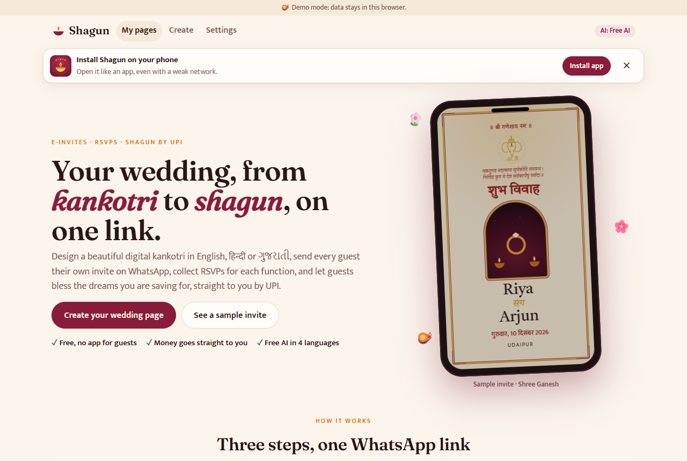

| Personal web invite | Exported invite (Gujarati, 1080 × 1920) | Guest list and sending |
|---|---|---|
| 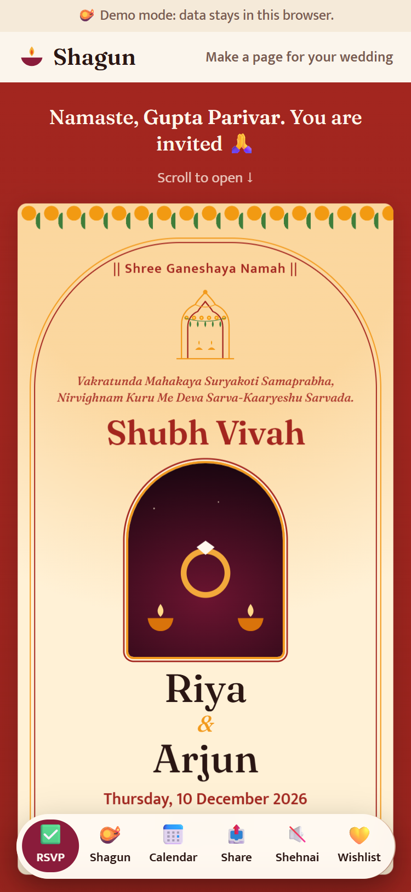 |  | 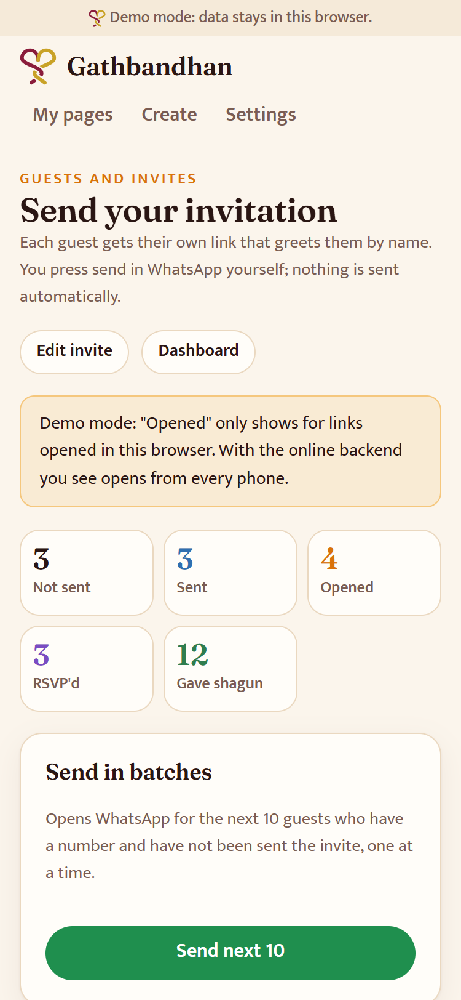 |

## Features

### E-invite: a digital kankotri
- **Ten styles, each with its own layout**, not one layout in different colours. All art is original SVG drawn in code (no stock art): *Shree Ganesh classic* (double-ruled frame, kumkum red on ivory), *Rajasthani jharokha* (haveli arches, marigold toran, elephants), *Gujarati kankotri* (full bandhani pattern, mirror work, red and green), *South Indian temple* (gopuram, banana leaves, kolam), *Royal monogram* (gold filigree crest on maroon), *Modern minimal* (editorial type, knot monogram), *Floral watercolour*, *Mehndi line-art* (henna mandala), *Photo-first* (the couple's photo as a poster) and *Phulkari* (Punjabi embroidery bands). Colours are editable.
- **Style slider** on the landing page and in the designer: the centred card shows each style, with arrows, dots, swipe, arrow keys, and an autoplay that pauses on touch and stays off for reduced motion. "Use this style" opens the designer with it selected.

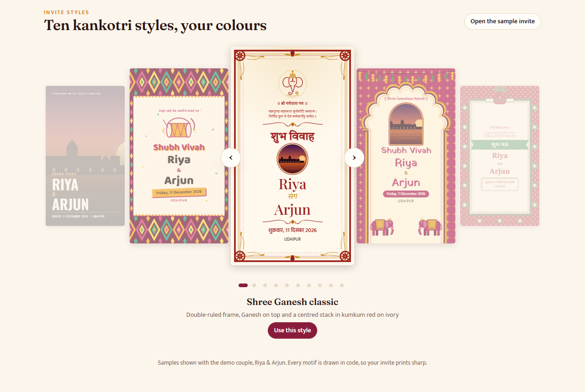
- **Multi-page invite**: cover (invocation, optional Ganesh shlok, *Shubh Vivah*, names, date), invitation ("With the blessings of… we cordially invite you and your family"), families (grandparents, both sets of parents, *Swagatotsuk* and *Darshanabhilashi* name lists), the functions three to a page, and a closing page with QR codes for RSVP, shagun and the venue map.
- **Four languages**: English, Hindi, Gujarati and Hinglish, with Tiro Devanagari Hindi, Rasa and Mukta Vaani loaded from Google Fonts only on invite pages (unicode-range subsets). Dates and times are localised (`गुरुवार, 10 दिसंबर 2026`, `ગુરુવાર, 10 ડિસેમ્બર, 2026`).
- **Animated web invite** at `#/i/:slug`, or `#/i/:slug/:guestToken` to greet one guest ("Namaste, Gupta Parivar"). Pages turn in as you scroll; a floating bar offers RSVP, give shagun, add to calendar, share, and a soft **shehnai** synthesised with the Web Audio API (off until tapped, no audio files).
- **Exports in the browser**: every page as a 1080 × 1920 PNG (WhatsApp status size) and the whole invite as a PDF, using html-to-image (lazy-loaded) and a small JPEG-to-PDF writer.

### Guest list and sending
- Add guests by hand, **import a CSV**, **paste** lines from contacts or Excel ("Pooja Bua +91 98765 01234"), or use the **phone contact picker** on Android. Duplicates are skipped by phone number or name.
- Each guest gets a personal link and a greeting ("Sharma Parivar"). **Send on WhatsApp** opens `wa.me` with a personalised message; AI can rewrite the message in any of the four languages and three tones.
- **Send next 10**: a queue that opens WhatsApp one guest at a time. Nothing is ever sent automatically.
- **Tracking**: not sent → sent → opened → RSVP'd → gave shagun, with counts and filters by status and group. With the backend, opens are recorded from every phone; in demo mode only opens in the same browser count.

### Wedding page, RSVPs and shagun
- **Public page** per wedding with the parents' names, a **functions timeline** (date, time, venue, Google Maps link, dress code) with **Add to Google Calendar** and **.ics** downloads, an **our story** timeline, a **photo gallery**, and progress per dream with the couple's **goal updates** ("Flights booked!").
- **RSVP** per function with party size, side and a note. The couple sees headcount per function and exports a CSV for the caterer.
- **Shagun by UPI**: pick a dream, tap ₹501, ₹1,100, ₹2,100 or ₹5,100 (or any amount up to the ₹1,00,000 UPI limit), choose bride's or groom's side, and pay with a standard NPCI `upi://pay` link or QR. The money never touches Shagun; the couple verifies each blessing against their bank app.
- **Upload your UPI QR**: couples who do not know their UPI ID can upload a screenshot of the "Receive money" QR from GPay, PhonePe, Paytm or BHIM (or, on phones, **scan it with the camera**). It is decoded on the device with the browser's BarcodeDetector or, where that is missing, a lazy-loaded jsQR; the image is never uploaded or stored. Only `pa` (UPI ID) and `pn` (name) are kept, the UPI ID is validated, and the couple confirms "Found: name@okaxis (Riya Sharma), is this correct?" before the form is filled. Not-a-QR, non-UPI QRs, blurry images and shop QRs each get a clear message.

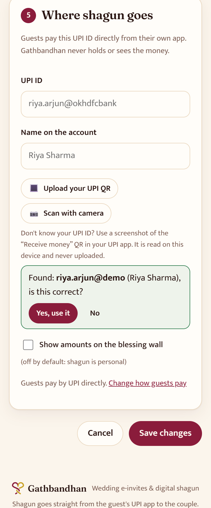
- **Optional: Razorpay (instant confirmation)**, chosen per wedding on **Dashboard → 💳 Payments**. Guests pay by UPI, card or netbanking in Razorpay Checkout (loaded only on the give page, only in this mode), and the blessing is marked **"✓ Paid"** automatically, but only after a Supabase Edge Function has checked Razorpay's signature. Each order carries a **Razorpay Route** transfer to the couple's own linked account, so the money settles to them. The couple sees the fee (about 2% + GST) before enabling it and chooses who bears it: the couple, or the guest as a "convenience fee" line. A webhook confirms payments even if the guest closes the tab; slow confirmations are polled; closing Checkout or a failed payment offers **Try again** on the same order. With a `rzp_test_…` key everything says **"Test mode, no real money"** and lists Razorpay's test UPI ID and card. If the payment server is not deployed yet, guests are quietly sent to direct UPI. Setup: **[docs/RAZORPAY_SETUP.md](docs/RAZORPAY_SETUP.md)**.
- **Blessing wall**, live across tabs (demo) or devices (backend). Razorpay-verified blessings carry a **✓ Paid** badge. Amounts stay hidden unless the couple shows them; phone numbers are never public.
- **Printable venue QR card** in A6 or A5.

### Couple dashboard
Cover hero with days to go, quick actions, stat cards (shagun blessed, verified in bank vs guest-confirmed, paid via Razorpay with fees, guests invited, invites opened, people coming, blessings), **shagun over time** (single-series area chart with a crosshair tooltip and a table view), **bride's side vs groom's side** (100% bar; the two hues were checked for colour-blind separation in light and dark mode), photo goal cards with update posting, a **recent activity** feed, a **wedding checklist**, RSVPs by function, co-owners, CSV exports (with payment method, Razorpay payment and order IDs, what the guest paid and fees) and AI thank-you notes in English, हिन्दी or Hinglish.

| Dashboard | Invite designer |
|---|---|
|  | 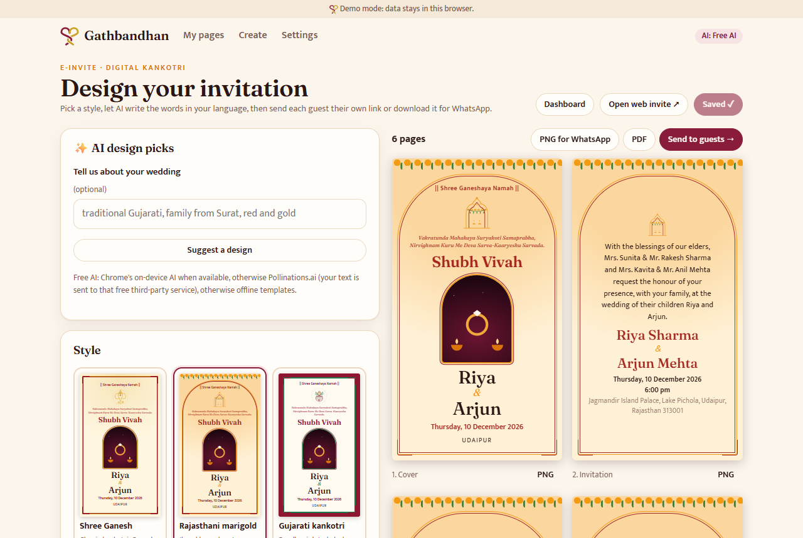 |

| Functions timeline | RSVP | Paying by UPI | Installed app |
|---|---|---|---|
| 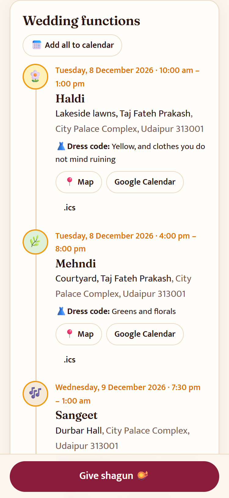 | 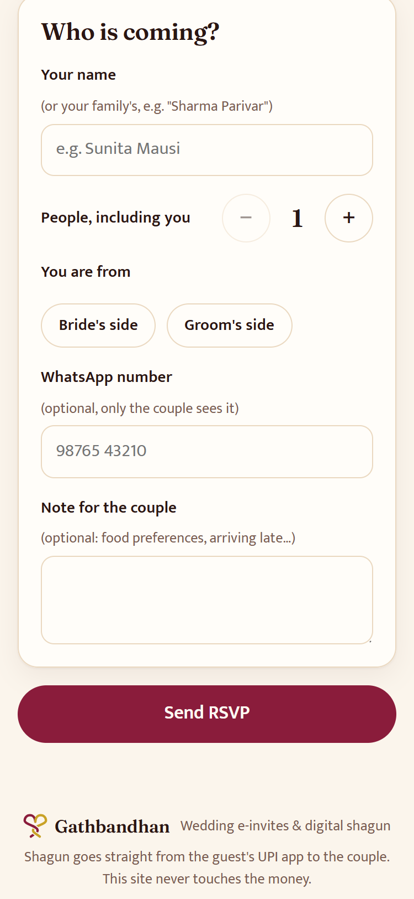 |  | 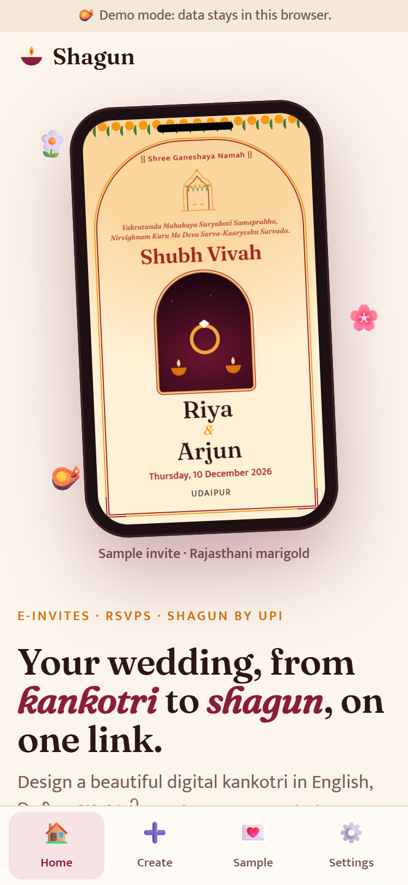 |

#### Razorpay mode (demo: simulated test-mode checkout)

| Checkout (demo, test mode) | Payment confirmed | ✓ Paid on the wall |
|---|---|---|
| 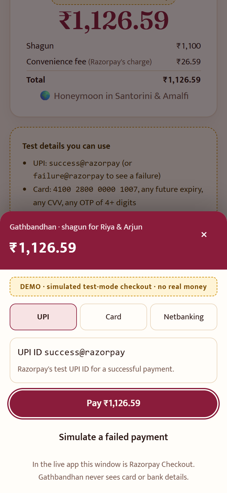 | 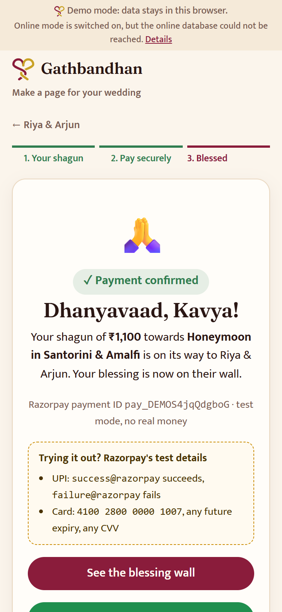 | 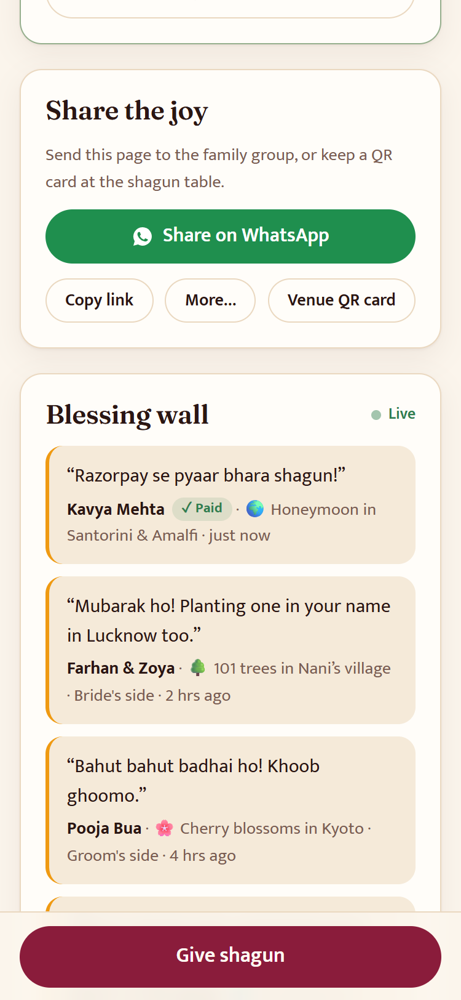 |

| How guests pay (couple settings and payout onboarding) | Dashboard: paid vs guest-confirmed, fees |
|---|---|
| 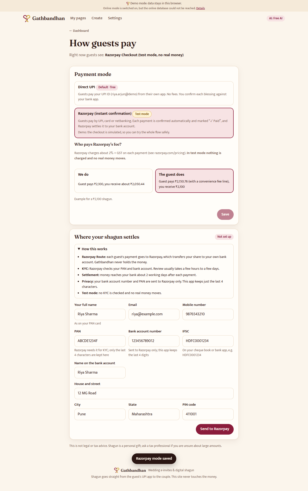 | 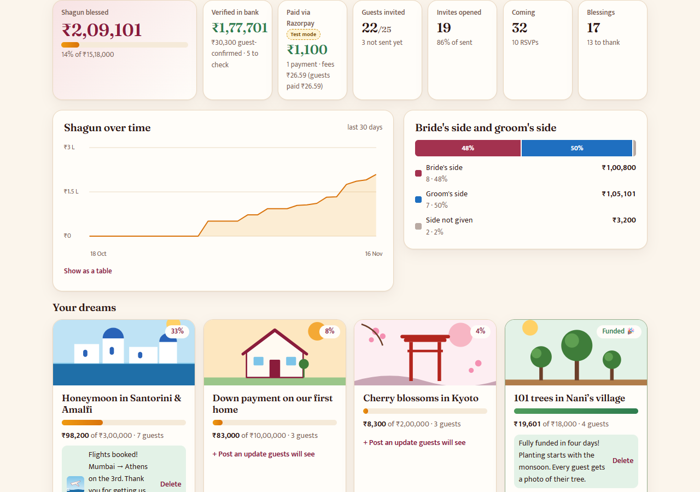 |

In demo mode (and on the sample wedding), Razorpay is shown as available with a **simulated checkout**, clearly labelled, that signs its pretend payments so the same verification code runs; couples can fill in the payout form and "simulate Razorpay approval". No real API is called.

<details>
<summary>More screens</summary>

| Wedding page | Blessing wall | Dashboard on a phone | Offline |
|---|---|---|---|
| 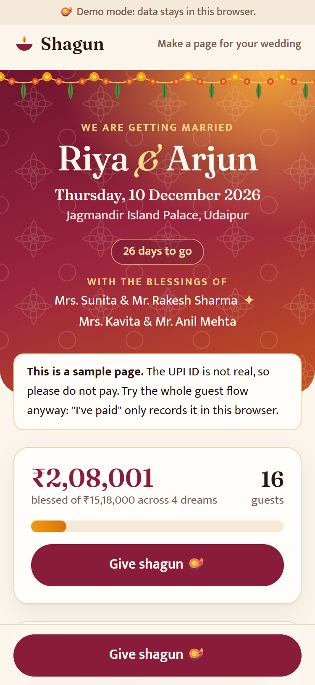 |  | 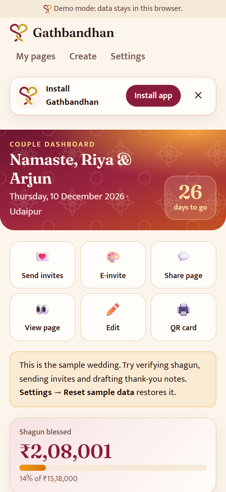 | 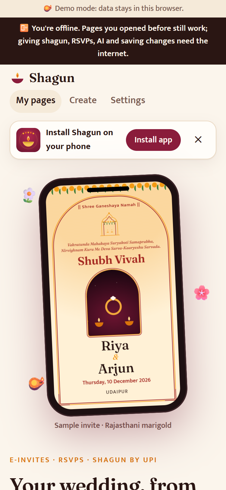 |

| Wedding page on desktop | Web invite on desktop | Guest list on desktop | Venue QR card |
|---|---|---|---|
|  | 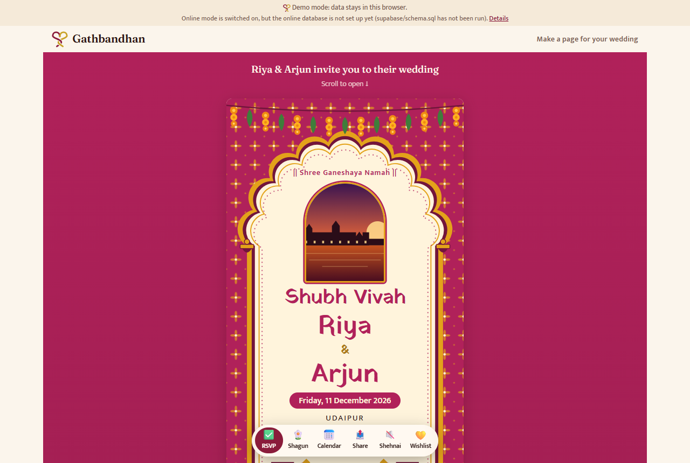 | 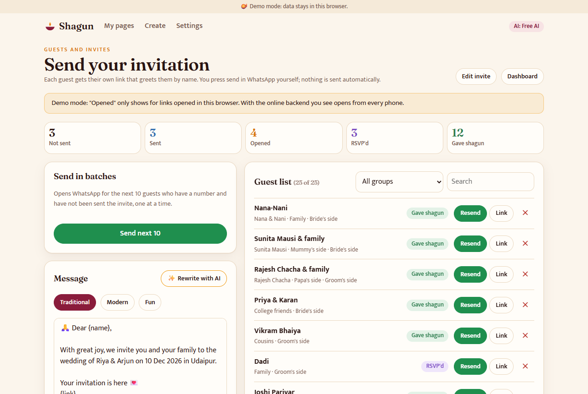 | 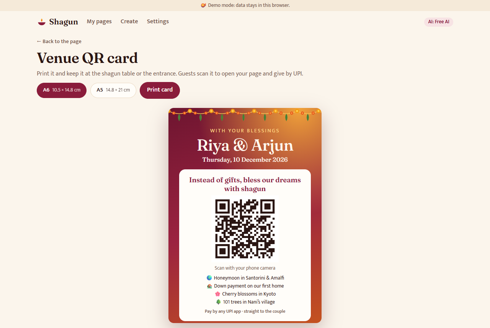 |

</details>

### Your account
- **First sign-in** asks four quick things ("Tell us about you": name, role in the wedding, optional phone, language), then carries on to where you were going. It can be skipped; the header then shows a small dot and "Complete your profile".
- **Account page** (`#/account`): profile with a photo you crop on the phone (stored as a 256 px JPEG), display name, phone (stored as E.164), city, role and language; **payment defaults** (UPI ID and payee name, with the same "Upload your UPI QR" reader) that pre-fill new wedding pages; **my wedding pages** with owner / co-owner and quick links; notification choices (saved now, emails come later); **sign out** or **sign out of all devices**; **download my data** (JSON) and **delete my account** (type DELETE to confirm, and choose whether your own pages go too).
- The header shows your photo or initials and first name, with a small menu. Your name greets you on the dashboard, and your language is the starting language for invites, stories and thank-you notes.
- In demo mode, "signing in" makes a local demo account in this browser (no email is sent), so all of this can be tried without the backend.

### Free AI, no key needed
Every AI feature goes through one chain and uses the first tier that answers. A tier that errors, times out, or returns something that fails validation hands over to the next, so the couple always gets text.

| Tier | What it is | When it is used |
|---|---|---|
| 1. Your own key | Gemini or Groq, added in Settings (stays in the browser) | Only if the couple added a key |
| 2. Chrome built-in AI | Gemini Nano through the Prompt API (`window.LanguageModel`), on-device and private | Desktop Chrome with the model already downloaded (Gathbandhan never starts a download); English and Hinglish only |
| 3. Pollinations.ai | Free, keyless text API | Unless turned off in Settings. The text is sent to that third-party service, which the app says next to every AI button. Its free tier allows about one reply every 45 seconds per IP and answers browsers on the published site, so Shagun respects a cooldown instead of waiting |
| 4. Offline templates | Deterministic writers and keyword rules in all four languages | Always; the last word |

AI writes: invite text (language, tone: traditional / modern / fun; the Ganesh shlok is always the canonical text, never AI-written), personal WhatsApp invite messages, **AI design picks** (template, colours, tone and language from the city, venue and the couple's wishes; unreadable colour pairs fall back to the template palette), the page story, the story timeline, dream suggestions with realistic targets, and thank-you notes. Optional **AI backgrounds** for invites come from Pollinations' image service: off by default, labelled "beta", and always layered over the drawn motifs so a failed image changes nothing.

## Demo mode and the online backend

Gathbandhan runs in two modes, chosen at start-up from `public/config.json`:

- **Demo mode** (empty keys): everything lives in the browser's localStorage, share links carry the wedding page itself (deflated into the URL), and the sample wedding is seeded. A thin strip says "Demo mode: data stays in this browser".
- **Online mode** (Supabase keys present): weddings, shagun, RSVPs and guests live in Supabase, links are short (`#/w/:slug`), couples sign in with an **email magic link** (plus a 6-digit code if the owner adds it to the email template and sets `signInCode` in config.json) and get an account page with their profile, a partner can be added as **co-owner**, photos go to Supabase Storage, and the blessing wall and dashboard update **in realtime**. supabase-js is loaded only in this mode (a lazy chunk).

On start the app reads `shagun_weddings` once. If the tables are missing (schema not run yet), the key is wrong, the project is paused or the network is down, it **falls back to demo mode** and the strip explains why, instead of breaking.

`public/config.json`:

```json
{
  "supabaseUrl": "https://<project>.supabase.co",
  "supabaseAnonKey": "<publishable or anon key>",
  "razorpayKeyId": "rzp_test_…"
}
```

The anon/publishable key and the Razorpay **Key ID** are meant to be public; **Row Level Security** protects the data, and the Razorpay **Key Secret** lives only in Supabase Edge Function secrets (the app ignores anything in `razorpayKeyId` that is not a key id). Setup for a non-technical owner, click by click: **[docs/SUPABASE_SETUP.md](docs/SUPABASE_SETUP.md)**.

### Database and security (`supabase/schema.sql`)
One idempotent script to paste into the Supabase SQL editor. Every table, function and the photo bucket is prefixed `shagun_` so the project can be shared with other apps. The prefix (like the `sg.*` browser storage keys) comes from the app's original name, Shagun, and is kept so existing data and the schema still match.

- **Guests (anon)**: read wedding pages; read totals and the blessing wall only through `shagun_public_activity()` (a security-definer function that never returns phone numbers, and returns amounts only if the couple shows them); **insert-only** on contributions (₹1 to ₹1,00,000, message up to 280 characters, the dream must exist; a trigger forces *guest confirmed*, no thank-you time and server time) and RSVPs (party of 1 to 20, only functions on the page).
- **A guest with a personal link**: `shagun_guest_invite()` reveals only their own name and greeting; `shagun_guest_mark()` can only tick opened / RSVP'd / gave. The guest list itself is never readable.
- **The couple** (email listed in `shagun_wedding_owners`): edit the wedding, read every contribution, RSVP and guest, update only `status` and `thanked_at` (column grants), add co-owners, and upload photos only into their wedding's folder. The last owner cannot be removed.
- **Razorpay payments**: `shagun_weddings.payment_mode` (`upi_direct` default, or `razorpay`) and `fee_bearer` are the couple's; `razorpay_active` is set only by a trigger from the payout account. Contributions gain `provider`, Razorpay order and payment IDs, `charged_amount`, `guest_fee`, `fee_amount` and `paid_at`, and the statuses `pending`, `paid` and `failed`. An insert trigger forces every guest or couple insert to *guest confirmed* / direct UPI; only the service role (the Edge Functions) can create Razorpay rows, always as *pending*. An update trigger lets couples flip only direct-UPI rows between *guest confirmed* and *verified*, never set *paid*. Pending and failed attempts are left out of totals and the wall, and `shagun_order_status()` tells the give page one order's status while it waits.
- **`shagun_payout_accounts`** (the couple's Route linked account): readable only by owners, writable only by the service role; checks allow only the **last four** digits of the bank account and PAN, so full numbers cannot be stored.
- The Razorpay additions were checked with 27 more PGlite assertions (run twice): anon cannot insert status or provider, owners cannot set *paid* or `razorpay_active`, service-role *pending* → *paid* is idempotent, pending rows stay hidden, the payout table is private, and full bank numbers are rejected.
- **`shagun_profiles`** (one row per signed-in person, keyed by their auth user id): default grants are revoked, then signed-in people get only the columns they need, and RLS limits select, insert, update and delete to their own row; anon has nothing. Avatars live in `shagun-photos/avatars/<user id>/`, writable only by that person (no wedding may use `avatars` as its id). **Delete my account** goes through the `shagun-delete-account` Edge Function, which checks the caller's token and deletes only their own profile, avatar, sign-in and (if asked) the pages they own alone. Checked with 29 PGlite assertions after running the script twice.
- The script was run twice against an in-memory Postgres (PGlite) with Supabase-style `auth`/`storage` stubs and 41 checks as anon, owner, co-owner and stranger.

## Install it as a phone app

Gathbandhan is a Progressive Web App: a service worker caches the app shell, fonts and the pages you opened, so it opens without network, shows a clear offline notice for actions that need the internet, and offers a refresh when a new version is deployed.

- **Android (Chrome)**: tap **Install app** on the home page or in Settings, or the ⋮ menu → **Install app** / **Add to Home screen**.
- **iPhone / iPad (Safari)**: tap **Share** ⬆️ → **Add to Home Screen** → **Add**.
- **Laptop (Chrome or Edge)**: click the install icon at the right end of the address bar.

Installed, it opens full-screen with a bottom tab bar and respects the notch and home indicator.

## Architecture

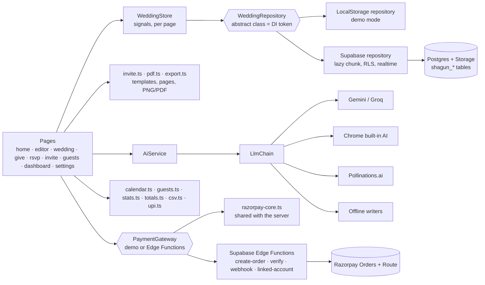

### Razorpay payment flow

1. The guest picks an amount; if the couple chose "guest pays the fee" a convenience-fee line is shown.
2. `razorpay-create-order` validates the request against the database (wedding in Razorpay mode, dream exists, ₹1–₹1,00,000, name and message limits, payout account active, or test mode), creates a Razorpay order with notes and a **Route transfer** of the couple's share, and records a *pending* contribution.
3. Razorpay Checkout opens (lazy-loaded `checkout.js`, name and phone prefilled, maroon theme).
4. On success `razorpay-verify` checks `HMAC_SHA256(order_id|payment_id, key_secret)` with a constant-time compare and marks the row *paid* (idempotent). If that is slow, the page polls the order status; independently, `razorpay-webhook` verifies `X-Razorpay-Signature` over the raw body and handles `payment.captured`, `order.paid`, `payment.failed`, transfer and account events, so a closed tab still ends up paid.
5. `razorpay-linked-account` (couple only: Supabase JWT + ownership check) creates or updates the Route linked account, stakeholder and settlement config, and stores only ids, status and last-four digits. In test mode, if Route is unavailable, it falls back to orders without transfers and the UI says "test-only".

All signature, validation, fee, webhook and CORS logic lives in one pure module, `supabase/functions/_shared/razorpay-core.ts`, used by the Deno functions, the Angular app and the tests. CORS allows only `https://konicamaheshwarii.github.io` and `http://localhost:*`. `supabase/functions-paste/` holds single-file copies for pasting into the Supabase dashboard (`npm run bundle:functions`).

- **Persistence behind an interface.** Components and stores depend only on the abstract `WeddingRepository`. `main.ts` reads `config.json`, and only when keys are present dynamically imports the Supabase module, probes it, and provides its repository and auth service in place of the demo ones.
- **Public and owner reads are separate.** Guests get `getPublicActivity()` (totals and the wall); the dashboard gets `listContributions()`, `listRsvps()` and `listGuests()`. The localStorage repository applies the same masking as the SQL function, so both modes behave alike.
- **Invite pages are sized in container units**, so one component renders the 210 px style picker, the phone invite and the 1080 × 1920 export identically.
- **Signals all the way down**: zoneless change detection, `OnPush`, `input()` route params, `computed` totals and stats.
- **Lazy routes, small start**: about 97 kB transferred on first load (including the service worker client); supabase-js, html-to-image and each page load on demand.

## Getting started

```bash
npm install
npm start          # http://localhost:4200
npm run test:ci    # unit tests in headless Chrome
npm run test:functions   # Razorpay core with Node's crypto (no Deno needed)
npm run e2e        # Playwright end-to-end tests against the production build (Chromium)
npm run build:pages
```

Everything works in demo mode out of the box. For online mode, follow [docs/SUPABASE_SETUP.md](docs/SUPABASE_SETUP.md).

## Testing

395 unit tests (Jasmine + Karma, headless Chrome), 4 Node tests for the Razorpay core, and 141 Playwright end-to-end tests (see below). The unit tests include:

- the UPI QR reader: GPay, PhonePe, Paytm and BHIM style payloads, URL-encoded (and Hindi) names, `+` for spaces, an uppercase scheme, merchant extras dropped, duplicate keys, and the errors for other QRs; plus decoding QR images drawn by the app's own generator, blank images, non-images and a badly blurred QR

- Razorpay: HMAC-SHA256 against RFC 4231 and Node-computed vectors, checkout and webhook signatures (tampered bodies, wrong secrets, malformed ids), webhook event handling, order input validation, fee maths for both fee bearers, the order and Route payloads, payout form checks and masking, CORS, the Edge Function client's "being set up" fallback, the demo gateway, totals that ignore pending and failed attempts, and the give flow with a mocked Checkout (success, failure and retry on the same order, closed window, slow verification with polling, fallback to direct UPI)

- the Supabase repository against a mocked client (public columns only, insert-only guest writes, the RPC wall, slug uniqueness, photo upload and clean-up, co-owners, realtime subscriptions, friendly RLS errors) and the start-up probe that falls back to demo mode
- the AI chain with mocked tiers (fall-through on errors, timeouts and invalid replies, language skipping, caller abort), the Chrome Prompt API and Pollinations providers (rate-limit cooldown), and validators for invite text, WhatsApp messages and design picks
- invite text in four languages, page layout, template contrast, localised dates, the PDF writer and JPEG parsing
- guest import (CSV with headers, pasted contacts), de-duplication, tokens and personal messages
- calendar files (IST to UTC, RFC 5545 escaping and line folding, Google Calendar links), RSVP headcount and CSV
- dashboard stats (running totals, side split, invite funnel, activity feed, checklist), the PWA service, the RSVP and give flows, share links, formatting, UPI links and totals

Browser checks with Puppeteer at 375 px and 1280 px in demo mode, with Supabase and Razorpay hosts blocked: the couple switches to Razorpay and fills the payout form (bank and PAN never stored in full), a guest pays through the simulated checkout after a failed attempt and a retry, the wall shows ✓ Paid, the dashboard shows paid vs guest-confirmed totals, fees and payment IDs, the CSV includes them, and direct UPI still works unchanged. The UPI QR upload was checked with QR images rendered by the app itself (the give page's UPI QR with amount and note, and the venue card's link QR) plus an image without a QR: the right message for each, the form filled after confirming, no image kept and no network request while reading. Earlier checks: guest page, functions and calendar download, give flow with side, RSVP, personal invite (greeting, page animation, shehnai toggle, RSVP ticks the guest off), guest list import and the send queue, invite designer in Hindi and Gujarati with PNG and PDF export, dashboard chart tooltip, CSV export, goal updates and the editor. A production build served under `/gathbandhan/` was checked for a valid manifest (no installability errors in Chrome), an active service worker, and offline loading of the home page, wedding page and invite. A config pointing at a database without tables was checked to fall back to demo mode with the notice.

**End-to-end tests** (Playwright, Chromium, `e2e/`): one spec per flow group in **[docs/FLOWS.md](docs/FLOWS.md)**, which documents every couple and guest flow as a manual test script and ends with a test report. They run against the production build served under `/gathbandhan/`, mostly in demo mode on a 390 × 844 phone, with key flows also at 1280 × 860. The online paths (magic-link sign-in, welcome and profile, live wedding page, contributions and RSVPs, the realtime wall, Razorpay order and verification, payout onboarding, delete account) run against an in-memory **Supabase mock** (auth, REST, RPC, storage, Edge Functions and the realtime websocket) and a mock of Razorpay's `checkout.js`. Every test blocks `*.supabase.co`, `checkout.razorpay.com` and `api.razorpay.com` and fails if a request gets past the mocks; no email is ever sent. A layout pass checks every main screen at 375 px in light and dark mode (with Hindi and Gujarati content) for sideways scrolling and saves screenshots. `npm run e2e` builds first; `E2E_SKIP_BUILD=1 npm run e2e` reuses the last build.

CI (GitHub Actions) runs the unit tests, the Razorpay core tests and a production build with `--base-href /gathbandhan/`, then the end-to-end tests (with cached browsers), and deploys `main` to GitHub Pages only when both pass.

## Limitations

- In demo mode, data lives in the browser where it was made; guests on other phones can still pay by UPI, but the couple's dashboard only sees what was recorded in their browser. Online mode removes this.
- "I've paid" is the guest's word; UPI intent links give no payment callback without a gateway, so the couple verifies each blessing. Razorpay mode removes this, at the cost of gateway fees.
- Razorpay mode: the Edge Functions are not deployed yet and need the owner's Key Secret (see the setup guide); live payments need Razorpay KYC and Route approval. The functions were type-checked and their core logic unit-tested, but have not run against Razorpay's API from this repo. Order creation is not rate limited beyond validation, and abandoned *pending* rows are kept (hidden) rather than cleaned up.
- Some UPI apps limit intent links for person-to-person payments; the pay screen always shows the UPI ID too.
- Supabase's built-in email sender allows only a few sign-in emails per hour; enough for a couple, and a free SMTP service can be added later.
- Guest inserts are not rate limited beyond the database checks; a determined spammer could add fake blessings that the couple then removes.
- Pollinations' free tier answers only from the published site and about once every 45 seconds; between replies the offline templates take over. Chrome's on-device AI needs desktop Chrome with the model already downloaded.
- The sample weddings use fake UPI IDs (`…@demo`) and fake phone numbers (`+91 90000 …`) so nobody can pay or call them by mistake.

## License

[MIT](LICENSE)
