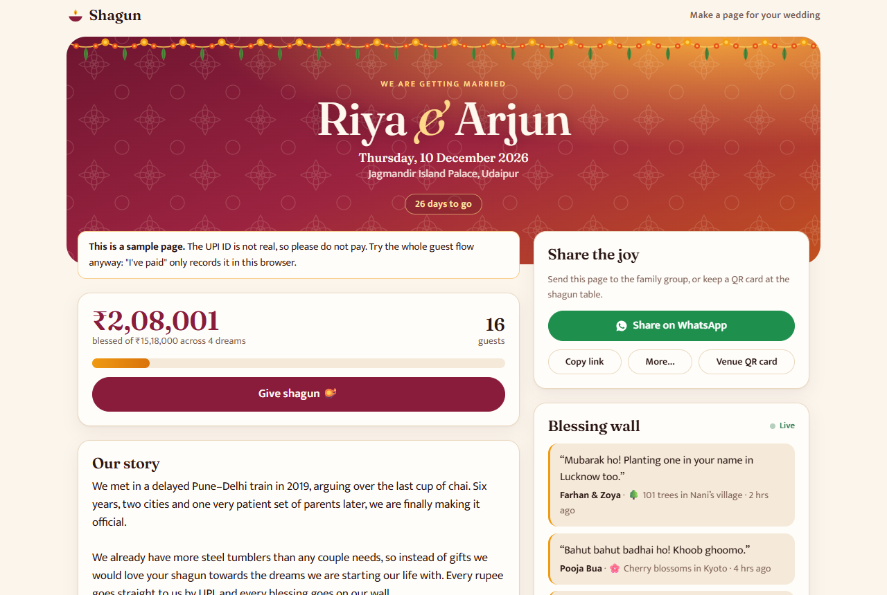
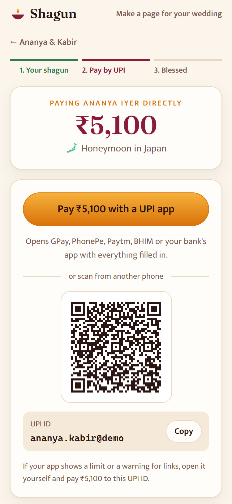
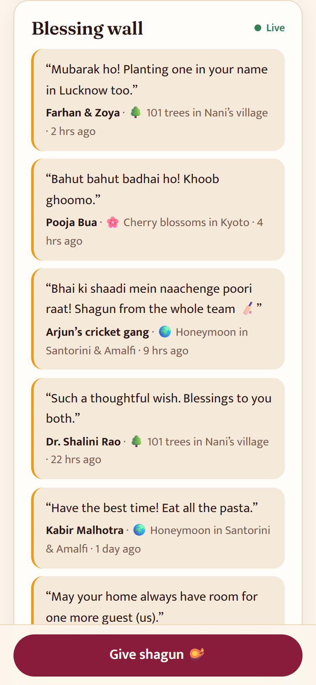
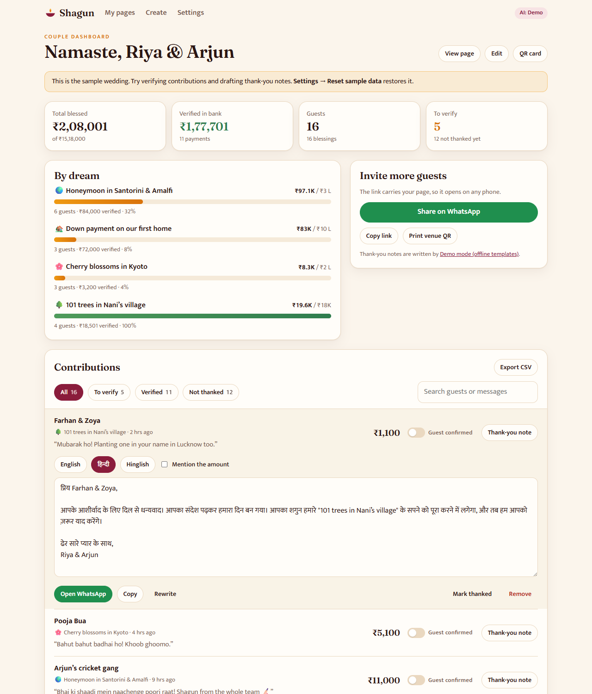
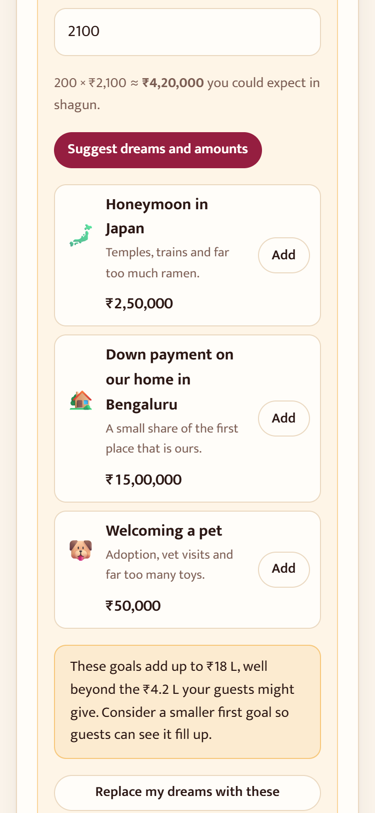
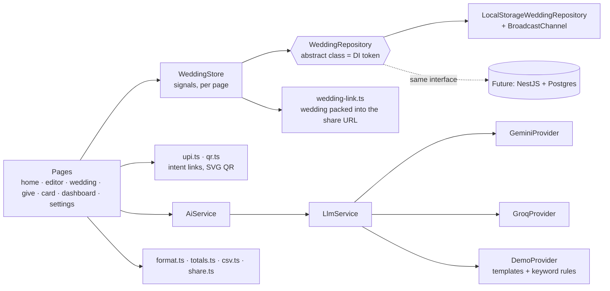

# Shagun: a wedding wishlist guests bless by UPI


At Indian weddings, guests give gifts the couple did not ask for: the fourth mixer-grinder, another dinner set. Shagun turns the cash gift guests *already* give into something meaningful. The couple lists two to five real dreams (a honeymoon in Europe for ₹3,00,000, a down payment on their first home, a trip to Japan), shares one page on WhatsApp, and every guest blesses a dream with any amount, paid straight to the couple from their own UPI app. 200 guests × ₹2,000 = ₹4,00,000: the honeymoon, funded.

It is deliberately framed as **digital shagun**, not a fundraiser, because Indian couples hesitate to "ask for money". Unlike generic registries, it is UPI-first, WhatsApp-native, has a printable QR card for the venue and a blessing wall, and AI drafts personal thank-you notes in English, Hindi or Hinglish.

**[▶ Live demo](https://konicamaheshwarii.github.io/shagun-wishlist/)**: opens with a sample wedding (Riya & Arjun) in offline Demo mode. No key, sign-up or backend needed.



| Guest view on a phone | Paying by UPI | Blessing wall |
|---|---|---|
|  |  |  |

## Features

- **Wedding page in three minutes.** Names, date, venue, a cover (four festive presets or your own photo, resized on the device), a short story, and two to five dreams, each with a title, a target in rupees, an emoji or photo and one line of description. Typed reactive forms with custom validators for UPI IDs, dates and the number of dreams.
- **Public page per wedding** at `#/w/:slug`, built for guests who open it from WhatsApp on a phone: a toran-and-marigold hero, countdown, total blessed, guest count, a progress bar per dream (with a "Funded" state), and a sticky "Give shagun" button. Works and looks right at 375 px.
- **Guest flow with real UPI payments.** Pick a dream, tap a shagun amount (₹501, ₹1,100, ₹2,100, ₹5,100; they end in 1 for a reason) or type any amount, add a name, a blessing and optionally a WhatsApp number. The app then builds a standard NPCI intent link, `upi://pay?pa=…&pn=…&am=…&cu=INR&tn=…`, shown as a "Pay with a UPI app" button on phones and as a QR code on desktops, plus a copyable UPI ID as a fallback. The money goes directly from the guest's app to the couple; no gateway or backend ever touches it. Amounts are capped at the ₹1,00,000 UPI P2P limit.
- **Trust, not magic.** After paying, the guest taps "I've paid" and the contribution is recorded as *guest confirmed*. The couple flips it to *verified* on their dashboard after checking their bank app.
- **Share the Indian way.** WhatsApp share with a prefilled invite, copy link, the native share sheet, and a **printable venue QR card** in A6 or A5 (sized in container units so the preview and the print match; `@page` is set per paper size).
- **Live blessing wall.** Messages appear instantly across tabs (BroadcastChannel + `storage` events). Amounts stay private by default, because shagun is personal; the couple can choose to show them.
- **Couple dashboard.** Totals, verified money, guests still to verify or thank, progress by dream, filters (to verify, verified, not thanked), search, optimistic verify toggles, **CSV export** (Excel-safe UTF-8 BOM, formula-injection guard, dd/mm/yyyy dates) and per-guest thank-you notes.
- **AI, bring your own key, with an offline Demo mode:**
  - *Write our story* from how you met, a few details, a tone (warm, playful, poetic) and a language. Streams in as it is written.
  - *Suggest dreams and amounts* from free text ("honeymoon in Japan, a flat in Pune, maybe a dog"), with a reality check against guests × typical shagun.
  - *Thank-you notes* per guest in English, हिन्दी or Hinglish, responding to their blessing, optionally mentioning the amount. Edit, copy, or open WhatsApp straight to the guest's number.
- **Indian formatting everywhere:** ₹ with lakh/crore grouping (`₹15,18,000`, `₹4.2 L`), dates as `12 Dec 2026`, CSV dates as `dd/mm/yyyy`.
- **Light and dark themes**, keyboard-accessible controls, focus styles, `aria-live` updates and reduced-motion support.

| Dashboard with a Hindi thank-you note | AI suggests dreams and amounts | Venue QR card |
|---|---|---|
|  |  |  |

## Architecture



- **Persistence behind an interface.** Components and stores depend only on the abstract `WeddingRepository` (async, Observable change feed). The app provides `LocalStorageWeddingRepository` in `app.config.ts` so it runs on GitHub Pages with no backend. A server implementation, for example **NestJS + Postgres** behind a small REST API, can implement the same eight methods and be swapped in with one provider line; nothing else changes.
- **Links that work without a server.** A static site cannot look a wedding up for a guest on another phone, so share links carry the wedding page itself: packed into a positional array, deflated with `CompressionStream` and base64url-encoded (about 800 characters for a full page). Decoding validates every field, including the UPI ID, and rejects tampered links.
- **One output contract for AI and Demo.** The offline writer returns the same JSON a model is asked for, and both go through the same validator (de-duplication, emoji check, clamping, rounding targets to amounts people actually set). Prompts fence user text in tags and treat it as data. The BYO-key provider layer (Gemini, Groq, SSE streaming) is shared with my other portfolio apps.
- **Signals all the way down.** Zoneless change detection, `OnPush` everywhere, `input()` route params via component input binding, `computed` totals, and a page-scoped `WeddingStore` that refreshes when the repository reports a change from this or another tab. Stale AI drafts are discarded by a per-guest request sequence.
- **Lazy routes, small bundle.** Each page is its own chunk; the initial load is about 74 kB transferred.

```
src/app
├── core
│   ├── data/            WeddingRepository (interface), LocalStorage implementation, seed data
│   ├── llm/             provider interface, Gemini, Groq, Demo, SSE reader
│   ├── ai/              prompts + validation, offline demo writer, AiService
│   ├── upi.ts           UPI intent links and VPA validation
│   ├── qr.ts            QR matrix -> SVG path
│   ├── wedding-link.ts  share-link encoding
│   ├── format.ts        ₹ lakh grouping, Indian dates
│   ├── totals.ts  csv.ts  share.ts  util.ts
│   └── wedding.store.ts settings.store.ts
├── features/            home · editor · wedding · give · card · dashboard · settings
└── shared/              QR, toran, toasts, pipes, clipboard, image resize
```

## Getting started

```bash
npm install
npm start          # http://localhost:4200
npm run test:ci    # unit tests in headless Chrome
npm run build
```

Everything works in Demo mode out of the box. To use a real model, open **Settings** and paste a free key: [Gemini](https://aistudio.google.com/apikey) · [Groq](https://console.groq.com/keys). Keys stay in your browser and go straight to the provider.

## Testing

76 unit tests (Jasmine + Karma, headless Chrome) cover:

- lakh/crore formatting, amount parsing, Indian dates, countdowns
- UPI: VPA validation, intent-link encoding (`@` kept, names and notes encoded), the ₹1 lakh cap, note sanitising
- totals per dream, verified vs guest-confirmed money, funded state, contributor de-duplication
- CSV quoting, formula-injection guard and BOM
- share-link round trip, photo stripping, rejection of damaged or tampered links
- the localStorage repository: seeding, unique slugs, verify/delete, change events, quota errors, corrupted storage
- prompt fencing, JSON extraction, goal validation and rounding
- the offline writer in all tones and languages, plus the Demo provider's streaming
- the editor form validators and mapping
- the guest flow component end to end: preselected dream, validation, UPI link, recorded blessing

The full journey (create a page with AI → public page → guest pays and blesses → dashboard verify → Hinglish/Hindi thank-you note → CSV export → share link opened on a fresh device) was also walked through in a real browser with Puppeteer at 375 px and 1280 px.

CI (GitHub Actions) runs the tests and a production build with `--base-href /shagun-wishlist/` on every push, then deploys `main` to GitHub Pages.

## Limitations

- With the localStorage repository, contributions live in the browser where they were made. A guest on another phone can open the page and pay the couple by UPI (the money always arrives), but the couple's dashboard only sees contributions recorded in their own browser. A backend implementing `WeddingRepository` removes this limit.
- "I've paid" is the guest's word; UPI intent links give no payment callback without a payment gateway. That is why every contribution starts as *guest confirmed* until the couple verifies it.
- Some UPI apps limit or warn on intent links for person-to-person payments. The pay screen always shows the UPI ID to pay manually.
- The sample wedding uses a fake UPI ID (`riya.arjun@demo`) so nobody can pay it by mistake.

## License

[MIT](LICENSE)
