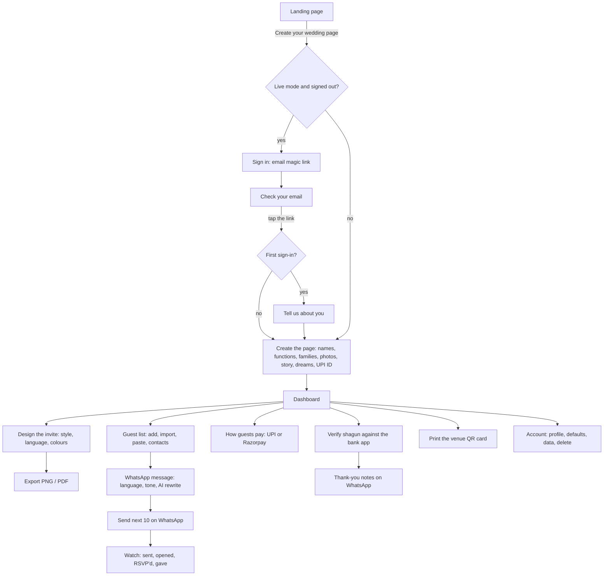
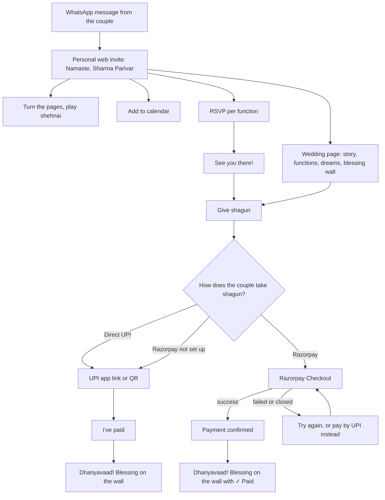

# Gathbandhan: every user flow

This document describes everything a person can do in Gathbandhan, step by step. It is written for the owner (no code knowledge needed) and doubles as a **manual test script**: follow the numbered steps, and check that you see what the "You see" and "Expected" lines say.

Every flow here also has an **automated test** (Playwright, in the `e2e/` folder). The [Test report](#test-report) at the end lists which test covers which flow, the bugs this pass found and fixed, and what cannot be automated.

- [How to use this document](#how-to-use-this-document)
- [Demo mode and live mode](#demo-mode-and-live-mode)
- [The sample weddings](#the-sample-weddings)
- [Route map](#route-map)
- [Journeys at a glance](#journeys-at-a-glance)
- [Couple flows](#couple-flows) (C1 to C16)
- [Guest flows](#guest-flows) (G1 to G7)
- [App flows](#app-flows): install, offline, updates (P1 to P3)
- [Test report](#test-report)

---

## How to use this document

- **Who**: the person doing it. *Couple* means the bride, the groom, or anyone they made a co-owner. *Guest* means anyone with the link.
- **Start**: the address to open. Addresses use the live site, for example `https://konicamaheshwarii.github.io/gathbandhan/#/w/riya-weds-arjun`. Below, only the part after `#` is written, like `#/w/riya-weds-arjun`.
- **Steps**: what to tap or type, with **You see** describing the screen.
- **Expected**: the result when everything works.
- **Edge cases**: mistakes and unusual situations, and what the app should say.
- **Demo vs live**: what is different between the two modes (see the next section).

Testing on a phone matters most: most couples and almost all guests use one. Try each flow at least once in **dark mode** (Settings → Appearance → Dark) and once with **Hindi or Gujarati** content.

## Demo mode and live mode

Gathbandhan runs in one of two modes. The mode is decided when the app starts, from `public/config.json`.

| | Demo mode | Live mode |
|---|---|---|
| When | `config.json` is empty, **or** the online database could not be reached (a thin strip at the top says why) | `config.json` has the Supabase keys and the database answered |
| Where data lives | Only in this browser (localStorage) | In Supabase, shared by every phone |
| Sign in | Type any email: a local demo account is made at once, **no email is sent** | An emailed **magic link** (one tap). On the free plan the email has no code |
| Couple pages (dashboard, guests…) | Open to anyone in this browser | Need sign-in as an owner of that page |
| Share links | Carry the whole page inside the link | Short links like `#/w/riya-weds-arjun` |
| Razorpay | A clearly labelled **simulated** checkout, no money | Real Razorpay Checkout (currently in **test mode**: no real money) |
| "Opened" ticks on the guest list | Only opens in this same browser | Opens from every phone |
| Blessing wall | Live across tabs of this browser | Live across devices (realtime) |

The three **sample weddings** always stay in the browser, even in live mode, so anyone can try them without an account.

## The sample weddings

All names, phone numbers (`+91 90000 …`) and UPI IDs (`…@demo`) are made up. Nobody can pay them by mistake.

| Sample | Address | Invite style and language | How guests pay | Good for testing |
|---|---|---|---|---|
| **Riya & Arjun** (Udaipur), the main showcase | `#/w/riya-weds-arjun` | Rajasthani jharokha, English | Direct UPI | Everything; 52 guests in every state, many Hindi blessings |
| **Hetal & Parth** (Ahmedabad) | `#/w/hetal-weds-parth` | Gujarati kankotri, Gujarati | Razorpay (simulated), **guest pays the fee** | Gujarati content, Razorpay with a convenience fee |
| **Meenakshi & Rohan** (Bengaluru, Tamil bride and Punjabi groom) | `#/w/meenakshi-weds-rohan` | South Indian temple, English | Razorpay (simulated), couple pays the fee | Mixed families, a 07:30 muhurtham |

Each sample has 4 to 6 functions, 3 or 4 dreams, a story, photos, 46 to 52 guests and 23 to 26 blessings (verified, guest-confirmed and Razorpay-paid, in English, Hindi, Gujarati and Hinglish, some without a message), and about 25 RSVPs.

Useful **personal invite links** for testing:

| Link | Guest | State |
|---|---|---|
| `#/i/riya-weds-arjun/demo0001tk` | Nana & Nani ("Nana-Nani") | Already gave shagun |
| `#/i/riya-weds-arjun/demo0019tk` | Harsh Bhatt ("Bhatt Parivar"), invite language Gujarati | Sent |
| `#/i/riya-weds-arjun/demo0022tk` | Swati Didi ("Swati Didi & Jiju") | Not sent yet |
| `#/i/riya-weds-arjun/demo0024tk` | Lakshmi Aunty (no phone number) | Not sent yet |
| `#/i/hetal-weds-parth/ahmd0038tk` | Rajvi & Jay | Not sent yet |
| `#/i/meenakshi-weds-rohan/blru0037tk` | Anand & Kavitha | Not sent yet |

**Settings → Reset sample data** puts all three samples back the way they were.

## Route map

"Couple" means: in demo mode, anyone in this browser; in live mode, a signed-in owner or co-owner of that page. The three samples are open to everyone in both modes.

| Route | Screen | Who can open it |
|---|---|---|
| `#/` | Landing page (and "Your wedding pages" once you have one) | Everyone |
| `#/login` | Sign in | Everyone (signed-in people are sent on to their account) |
| `#/welcome` | First sign-in: "Tell us about you" | Signed in |
| `#/account` | My account | Signed in (otherwise → sign in) |
| `#/create` | Create a wedding page | Demo: everyone. Live: signed in |
| `#/w/:slug` | The wedding page guests see | Everyone |
| `#/w/:slug/give` | Give shagun | Everyone |
| `#/w/:slug/rsvp` | RSVP | Everyone |
| `#/w/:slug/card` | Printable venue QR card | Everyone (meant for the couple) |
| `#/w/:slug/dashboard` | Couple dashboard | Couple (others see "Only the couple can see this dashboard") |
| `#/w/:slug/edit` | Edit the page | Couple |
| `#/w/:slug/invite` | Invite designer | Couple |
| `#/w/:slug/guests` | Guest list and sending | Couple |
| `#/w/:slug/payments` | How guests pay (UPI or Razorpay) | Couple |
| `#/i/:slug` | Animated web invite | Everyone |
| `#/i/:slug/:token` | Personal web invite ("Namaste, Sharma Parivar") | Everyone with the link |
| `#/settings` | Settings (AI, theme, install, sample reset) | Everyone |
| anything else | Back to the landing page | |

In live mode, opening a couple page while signed out goes to `#/login?next=…`, and after signing in the app continues to that page.

## Journeys at a glance

### The couple's journey

### The guest's journey

---

## Couple flows

### C1. Landing page and the style slider

- **Who**: anyone, usually a couple deciding whether to use Gathbandhan.
- **Why**: understand what it does, see a sample, and start.
- **Start**: `#/`

**Steps**
1. Open the site. **You see** the headline "Your wedding, from kankotri to shagun, on one link", a phone mock-up whose sample invite changes style every few seconds, and (in demo mode) a thin strip "Demo mode: data stays in this browser".
2. Scroll to **Ten kankotri styles, your colours**. **You see** a slider with the sample couple's cover in the middle and its neighbours faded at the sides, the style name and a one-line description.
3. Tap **›** and **‹**. **You see** the next and previous style. Tap a dot to jump to a style. On a laptop, click the slider and use the **← →** keys. Swipe on a phone.
4. The slider moves by itself every few seconds; touching it or hovering pauses it. Tap **❚❚** to pause and **▶** to play.
5. Tap **Use this style**.
6. Tap **See a sample invite** (top) and **Open the sample page** / **See the couple's dashboard** (further down).
7. Open a question under **Questions families ask**.

**Expected**
- Step 5 opens the invite designer with that style already chosen ("✓ Your invite uses this style"): the sample's designer in demo mode, your own page's designer if you have one, or sign-in / create in live mode.
- The "Live sample wedding" section always shows **Riya & Arjun**.
- **Create your wedding page** opens `#/create` (demo) or sign-in first (live, signed out).

**Edge cases**
- With "reduce motion" switched on in the phone's settings there is no autoplay and no play button; the arrows still work.

**Demo vs live**: in live mode, signed out, both "Create" buttons go to sign-in with `next=/create`.

### C2. Sign in (magic link)

- **Who**: the couple (or a co-owner).
- **Why**: in live mode, only owners may edit a page and see its dashboard.
- **Start**: `#/login`, or any couple page while signed out (it adds `?next=`).

**Steps (live mode)**
1. **You see** "Welcome to Gathbandhan", "Sign in to *create your wedding page*" (the purpose changes with where you were going), an email box and **Email me a sign-in link**. On a laptop a festive art panel with a changing sample invite is on the left.
2. Type your email and tap **Email me a sign-in link**.
3. **You see** "Check your email" with an envelope, "We sent a sign-in link to *your address*", **Open Gmail** and **Open Outlook** buttons, a spam hint, and a disabled **You can resend in 1:00** that counts down.
4. After a minute the button becomes **Resend the link**. Tap it: a toast says "Sent a new link".
5. Open the email on the same phone and tap the link.
6. The app opens again, signed in, on the page you were going to (or your account page). The header shows your photo or initials and first name.

**Expected**: one tap in the email signs you in; no password.

**Edge cases**
- An invalid email: "Enter a valid email address." and nothing is sent.
- **Too many emails** (Supabase's free email allows only a few an hour): a friendly message "Our free email service sends only a couple of sign-in emails an hour… The link in the email we already sent still works."
- **Expired or used link**: back to sign-in with "Email link is invalid or has expired. Ask for a new link below."
- **Use a different email** goes back to the form with the address kept, to fix a typo.
- The link opens in a different browser (for example inside the Gmail app): that browser is signed in, not the first one. Open the link in the same browser you started in.
- There is **no 6-digit code** on the free plan. The code box appears only if the owner adds the code to the email template and sets `"signInCode": true` in `config.json` (see SUPABASE_SETUP.md, step 6).

**Demo vs live**: in demo mode the button says **Sign in to the demo**, a note says no email is sent, and any email signs in at once (a local demo account in this browser).

### C3. First sign-in: "Tell us about you"

- **Who**: someone signing in for the first time (no profile yet).
- **Why**: greet them by name, set their language, and fill in later forms.
- **Start**: automatic after the first sign-in (`#/welcome?next=…`).

**Steps**
1. **You see** "Namaste! Tell us about you" with four things: **Your name** (required), **I am the…** (Bride, Groom, Family, Planner, Other), **Mobile number** (optional) and **Language for invites and AI text** (English, हिन्दी, ગુજરાતી, Hinglish).
2. Fill them in and tap **Save and continue**.

**Expected**: a toast "Lovely to meet you, *first name*!", then the page you were going to. Your name shows in the header and the dashboard greets you; your language is the starting language for invites, stories and thank-you notes.

**Edge cases**
- No name: "Add your name…" under the field.
- A wrong mobile number: a message under the field. Indian numbers need no +91.
- **Skip for now**: no more redirects, but the header avatar shows a small dot and the menu offers **Complete your profile**.

**Demo vs live**: demo saves to this browser; live saves to the `shagun_profiles` table (your row only).

### C4. Account page

- **Who**: a signed-in person.
- **Why**: keep their details, defaults for new pages, privacy choices.
- **Start**: `#/account` (header menu → **My account**).

The page has a festive header ("Namaste, *name*", email, member since, and a ring showing how complete the profile is), and a list of sections (on a laptop a side menu; tapping one scrolls to it).

**4a. Profile**
1. Edit **Full name**, **Display name** (what we call you), **Mobile number**, **City**, **Your role** and **Preferred language**. "Unsaved changes" appears.
2. Tap **Save profile**. **Expected**: toast "Profile saved" and "✓ Saved".
3. **Add a photo** (or the camera button on the big avatar): pick a picture. **You see** a round cropper: drag to move, use the **Zoom** slider or arrow keys. Tap **Use this photo**. **Expected**: "Photo updated"; the header and the account show it. **Remove** takes it off ("Photo removed").
- Edge cases: a wrong mobile number shows a message under the field; a file that is not an image is refused with a message. Photos are cropped and shrunk to 256 px on the phone before saving.

**4b. Payment defaults**
1. Type your **Default UPI ID** and **Payee name**, or tap **Upload your UPI QR** and choose a screenshot of the "Receive money" QR from GPay, PhonePe, Paytm or BHIM (on phones also **Scan with camera**).
2. **You see** "Found: *upi id* (*name*), is this correct?". Tap **Yes, use it**. The boxes fill in; toast "UPI ID filled in from your QR. Save to keep it."
3. Tap **Save payment details**.
- **Expected**: new wedding pages start with this UPI ID and name. Existing pages are not changed.
- Edge cases: "not-a-upi" is refused ("Use the format name@bank…"); a QR that is not a UPI QR, a blurry photo, or a file that is not an image each get their own message; a shop QR is accepted with a warning. The image is read on the phone and never uploaded.

**4c. My wedding pages**: each page you own or co-own (with an **Owner** / **Co-owner** chip) and the samples (chip **Sample**), with links to Page, Dashboard, Invite and Guests. **Create a new wedding page** at the bottom.

**4d. Notifications**: two switches (a guest gives shagun, a guest RSVPs). Marked **Coming soon**: the choice is saved now ("✓ Saved"), emails come later.

**4e. Security**: "Signed in as …", **Sign out**, and **Sign out of all devices** (ends every session, including this one).

**4f. Privacy**
1. **Download my data**: downloads `gathbandhan-account-YYYY-MM-DD.json` with your profile and the pages you own.
2. **Delete my account…**: opens a red panel. If you own pages, a tick box **Also delete the wedding page(s) I own…** (with their names). Type **DELETE** (any case) and tap **Delete my account forever**.
- **Expected**: toast "Your account (and N wedding pages) were deleted. Take care!", signed out, back to the landing page. Without the tick, your pages stay online for guests. Co-owned pages stay with the other owners.
- Edge cases: the button stays disabled until DELETE is typed; **Keep my account** closes the panel. In live mode, if the delete function is not deployed: "Account deletion is not switched on yet… Nothing was deleted".

**Demo vs live**: a note says "Demo account… no email is ever sent"; both sign-out buttons only sign out this browser. Live: photo goes to Supabase Storage; delete goes through the `shagun-delete-account` Edge Function.

### C5. The header menu

- **Who**: a signed-in person. **Start**: any couple page.
1. Tap your avatar and name in the header. **You see** a menu with your name and email, **My account**, **My wedding pages**, **Sign out** (and **Complete your profile** while the profile has no name).
2. Arrow keys move between items; **Esc** or a tap outside closes it.
- **Expected**: **Sign out** shows "Signed out" and goes to the landing page; the header shows **Sign in**.

### C6. Create a wedding page

- **Who**: the couple. **Why**: the page guests open, and the base for the invite.
- **Start**: `#/create`.

**Steps**
1. **You see** "Create your shagun page" in five numbered cards. If your profile has a UPI ID (and your role is bride or groom), a line says "✓ Filled in your name, UPI ID… from your account".
2. **1. The two of you**: both names, the wedding date, venue, city; a cover colour (marigold, maroon, rose, peacock) or **+ Your photo**; parents' names under "With the blessings of".
3. **2. Your story**: type it, or tap **✨ Write it with AI**, answer "How did you meet?", pick a tone and language, and tap **Write our story**. Under it, a **story timeline** of moments (**✨ Draft with AI** writes three to five), and up to six **photos** with captions.
4. **3. Wedding functions**: tap **Haldi**, **Mehndi**, **Sangeet**, **Wedding**, **Reception** or **Function**. Each has a name, date, start and end time, venue, address, Google Maps link and dress code. ✕ removes one.
5. **4. Your dreams**: two to five, each with an icon (or a photo), a title, a target (₹1,000 or more) and a line for guests. **✨ Suggest with AI** asks what you are saving for, how many guests and the typical shagun, then suggests dreams with honest amounts (**Add** one, or **Replace my dreams with these**). ↑ ↓ reorder, ✕ removes.
6. **5. Where shagun goes**: your UPI ID and the name on the account (or **Upload your UPI QR**). **Show amounts on the blessing wall** is off by default.
7. Tap **Create my page**.

**Expected**: toast "Your page is ready. Share it with your family!" and the new page's dashboard. The page address is made from the names (`ishita-weds-aditya`); if taken, `-2` is added.

**Edge cases**
- Missing names, date, venue, UPI ID or name, or dreams without a title or with a target under ₹1,000: red messages under each, and "Some details are missing. Check the fields marked in red."
- More than five dreams: "Up to 5 dreams. Remove one first."
- **Try with sample details** fills names, date, venue and UPI ID and opens both AI helpers, so you can try the AI.
- AI never blocks you: if no online AI answers, built-in templates write the text.

**Demo vs live**: demo keeps the page in this browser and share links carry it (photos are left out of links). Live saves to Supabase, uploads photos to Storage, and makes you the owner.

### C7. Edit the page

- **Who**: the couple. **Start**: Dashboard → **✏️ Edit** (`#/w/:slug/edit`).
1. **You see** the same five cards, filled in, titled "Update your shagun page".
2. Change anything, then **Save changes** (toast "Changes saved", back to the dashboard) or **Cancel**.
3. **Delete page** (not on the samples) asks to confirm and removes the page with its blessings.
- A line under "Where shagun goes" shows how guests pay, with **Change how guests pay**.
- **Expected**: the guest page shows the changes at once (live: on every phone).

### C8. Co-owners (live mode)

- **Who**: an owner. **Why**: the partner or a sibling can manage the page too.
- **Start**: Dashboard → **Who can manage this page**.
1. **You see** the owners' emails ("You" next to yours).
2. Type the partner's email and tap **Add co-owner**. They appear in the list.
3. **Remove** asks to confirm, then removes them.
- **Expected**: the co-owner signs in with that email and sees the same dashboard. No email is sent: tell them on WhatsApp.
- Edge cases: an invalid email is refused; the last owner cannot be removed.
- **Demo**: not shown (no accounts to share with).

### C9. Invite designer (digital kankotri) and the animated web invite

- **Who**: the couple. **Start**: Dashboard → **🎨 E-invite** (`#/w/:slug/invite`).

**Steps**
1. **You see** "Design your invitation", **Dashboard**, **Open web invite ↗** and **Saved ✓** (becomes **Save invite** after a change). On a laptop the controls are on the left and the pages on the right.
2. **✨ AI design picks**: describe the wedding ("traditional Gujarati, family from Surat, red and green") and tap **Suggest a design**. **You see** a style, tone, language and colours with a reason. **Apply** uses it.
3. **Style**: a slider of **ten styles** (Shree Ganesh classic, Rajasthani jharokha, Gujarati kankotri, South Indian temple, Royal monogram, Modern minimal, Floral watercolour, Mehndi line-art, Photo save-the-date, Phulkari baraat). **Use this style** switches (and takes that style's colours; your words stay).
4. **Words**: pick the language (English, हिन्दी, ગુજરાતી, Hinglish) and tone (traditional, modern, fun). The words are rewritten in that language; **✨ Write with AI** writes them again. Edit the opening line, title, invitation and closing line; tick **Show the Ganesh shlok**.
5. **Families**: grandparents on both sides, *Swagatotsuk* and *Darshanabhilashi* name lists (one per line).
6. **Colours and photo**: **Ink**, **Gold** and **Paper** colour pickers (**Reset** returns to the style's colours); a cover photo from your gallery or **No photo**; an optional AI background (beta, off unless allowed in Settings).
7. **The pages** (right side): cover, invitation, families, functions (three per page) and a closing page with QR codes for RSVP, shagun and the venue. Tick **Preview a personal invite** to see "Dear Sharma Parivar".
8. **PNG** under a page downloads that page; **PNG for WhatsApp** downloads all pages; **PDF** downloads the whole invite.
9. **Save invite**.
10. **Open web invite ↗** opens the animated invite in a new tab.

**Expected**
- Pages update as you type. PNGs are 1080 × 1920 (WhatsApp status size), named `invite-<page>-1.png`…; the PDF (`invite-<page>.pdf`) has one page per invite page. A toast says "Downloaded. Share it on WhatsApp!".
- Hindi and Gujarati use proper fonts and localised dates (गुरुवार, 10 दिसंबर 2026).
- Saved designs stay after a reload.

**Edge cases**: an unreadable colour pair from AI falls back to the style's colours; export of a page with a photo from another site may fail with "Could not export: …".

### C10. Guest list

- **Who**: the couple. **Start**: Dashboard → **💌 Send invites** (`#/w/:slug/guests`).

**Steps**
1. **You see** "Send your invitation", and five big counters: **Not sent**, **Sent**, **Opened**, **RSVP'd**, **Gave shagun**. Tap one to show only those guests; tap again for everyone.
2. **Add guests**: **Name**, **Greet them as** ("Sharma Parivar", optional), **WhatsApp number**, **Invite language** (optional, otherwise the message's language), side (Bride's / Groom's) and **Group** (suggests groups you used). Tap **Add guest**: toast "*name* added".
3. **Paste a list**: one guest per line, like `Sunita Mausi, 98220 12345, bride, Mummy's side` or `Gupta Uncle +91 98110 66666`. Tap **Add these guests**.
4. **Import CSV**: a file with columns such as name, phone, side, group, greeting.
5. **From phone contacts** (Android Chrome only): pick people in the phone's own picker.
6. In the **Guest list**: filter by group, search, change each guest's invite language, **Link** (copies their personal link), **Send** / **Resend** on WhatsApp, ✕ to remove (asks first).

**Expected**: toasts like "3 guests added, 1 lines skipped". Duplicates (same phone, or same name without a phone) are skipped: "*name* is already on your list." / "Everyone there is already on your list."

**Edge cases**: a name shorter than two letters ("Add the guest's name."), a wrong number ("Enter a 10-digit Indian mobile number, or leave it empty."), an empty paste ("No names found. Put one guest per line.").

**Demo vs live**: a note says "Opened" only counts links opened in this browser in demo mode. Live: the guest list is private to the couple, and opens are recorded from every phone.

### C11. The WhatsApp message composer

- **Who**: the couple. **Start**: the guest list page, card **WhatsApp message**.
1. Pick the **language** (each label in its own script) and the **tone** (Traditional, Modern, Fun). **You see** a WhatsApp-style chat bubble with the message for one guest; **Preview for** changes the guest.
2. **Add the shagun link** (off by default, since some guests find being asked for money awkward) adds the shagun page link.
3. **✨ Rewrite with AI** writes a fresh message; "Written by …" says which AI.
4. **✏️ Edit text** shows the template: `{name}`, `{link}`, `{rsvp}` and `{shagun}` are filled in for each guest; `*bold*` and `_italic_` work in WhatsApp. **Use the standard message** undoes your edits.
5. **Copy** copies the message for the previewed guest ("Message copied. Paste it in WhatsApp."). **Open WhatsApp** opens WhatsApp with it.
- **Expected**: every guest's message carries their own link and greeting. A guest with their own language gets the message in that language ("In the list, *X* gets their invite in ગુજરાતી").

### C12. "Send next 10" and tracking

- **Who**: the couple. **Start**: guest list page, card **Send in batches**.
1. Tap **Send next 10**. **You see** "Sending 1 of 10", the guest's greeting, number and language, and the message.
2. Tap **Open WhatsApp for *name***. WhatsApp opens with the message; press send there. The app moves to the next guest.
3. **Skip** moves on without sending; **Stop** ends the batch. After the last one: "Done! Start the next 10 whenever you are ready."
- **Expected**: each opened guest moves from **Not sent** to **Sent**. When they open their link they move to **Opened**, after replying to **RSVP'd**, after giving to **Gave shagun**.
- Edge cases: only guests with a phone number who were not sent yet are queued; with none left, "Everyone with a phone number has been sent their invite." Nothing is ever sent automatically.

### C13. Dashboard

- **Who**: the couple. **Start**: `#/w/:slug/dashboard`.

**Steps and what you see**
1. A cover with "Namaste, *your name*", the date and city, and the **days to go**.
2. Quick actions: Send invites, E-invite, Share page, View page, Edit, QR card, Payments.
3. Stat cards: **Shagun blessed** (with progress to the total target), **Verified in bank** (and how many to check), **Paid via Razorpay** (when used; with fees and a Test mode chip), **Guests invited**, **Invites opened**, **Coming** (people from RSVPs), **Blessings** (and how many to thank).
4. **Shagun over time** (last 30 days): move a finger or the mouse over the chart for the amount on a day; **Show as a table** shows the numbers.
5. **Bride's side and groom's side**: one bar split by side, with amounts, counts and percentages.
6. **Your dreams**: each with progress, and **+ Post an update guests will see** ("Ryokan booked!", optional photo). Updates show on the guest page.
7. **Recent activity** (shagun, RSVPs, opens) and a **Wedding checklist** (done items ticked, each a link).
8. **RSVPs**: people per function (for the caterer), **See every reply**, and **Export CSV**.
9. **Invite more guests**: Share on WhatsApp, Share…, Copy link, Print venue QR. (Live: **Who can manage this page**, see C8.)
10. **Contributions**: filters **All / To verify / Verified / Not thanked**, by side, and search. Each row shows the guest, dream, side, time, message and amount.
    - Direct UPI rows have a switch **Guest confirmed ↔ Verified**: check your bank app, then switch it on.
    - Razorpay rows show **✓ Paid · Razorpay** and the payment ID instead.
11. **Thank-you note** on a row: a note written for that guest in **English**, **हिन्दी** or **Hinglish**, optionally mentioning the amount. Edit it, **Send on WhatsApp** (or **Open WhatsApp** without a number), **Copy**, **Rewrite**, **Mark thanked** / **Mark not thanked**, **Remove**.
12. **Export CSV** downloads every contribution (`shagun-<page>-<date>.csv`) with payment method, Razorpay IDs, what the guest paid and fees.

**Expected**: numbers add up with the guest page; verifying moves a row from "To verify" to "Verified"; marking thanked shows "Thanked ✓".

**Edge cases**: started-but-unfinished Razorpay payments are not counted ("N Razorpay payments were started but not completed"); a page opened from a share link (demo) only shows blessings made in this browser; a person who is not an owner sees "Only the couple can see this dashboard" with **Sign in**.

### C14. How guests pay (direct UPI or Razorpay) and payout onboarding

- **Who**: the couple. **Start**: Dashboard → **💳 Payments** (`#/w/:slug/payments`).
1. **You see** "Right now guests see: …" and two choices: **Direct UPI** (default, free; you confirm each blessing yourself) and **Razorpay (instant confirmation)** (with a **Test mode** chip while Razorpay is in test mode).
2. Choose **Razorpay**. **You see** "Who pays Razorpay's fee?" with an example: **We do** (guest pays ₹2,100, you receive about ₹2,050) or **The guest does** (guest pays a little more as a "convenience fee", you receive ₹2,100). Tap **Save**: "Razorpay mode saved".
3. **Where your shagun settles**: status chip (**Not set up**, **Under review**, **Active**, **Needs info**) and **How this works** (Route, KYC, settlement in about 2 working days, privacy).
4. Fill in your full name, email, mobile, PAN, bank account number, IFSC, name on the account and address. Tap **Send to Razorpay**: "Sent to Razorpay for review".
5. **You see** a summary with only the last four characters: "•••• 6789", "••••••234F". **Update details** to change them.
- **Expected**: once the account is active (or in test mode), guests pay through Razorpay and blessings are marked "✓ Paid" automatically.
- **Edge cases**: missing or wrong fields show messages under each; if the site owner has not connected Razorpay, the Razorpay choice is disabled ("Available after setup"); if the payment server is not reachable, a note says Razorpay is being set up and nothing is sent. The full bank number and PAN are never stored in the app.
- **Demo vs live**: on the samples and in demo mode the checkout is **simulated** and **Demo: simulate Razorpay approval** makes the account active at once. Live: the form goes to the `razorpay-linked-account` Edge Function; in test mode Route may be "test-only" (payments work but are not transferred to a bank).

### C15. Venue QR card

- **Who**: the couple. **Start**: Dashboard → **🖨️ QR card** (`#/w/:slug/card`).
1. **You see** a card with the couple's names, date, a QR code to the wedding page and a line inviting guests to bless them.
2. Choose **A6** (10.5 × 14.8 cm) or **A5** (14.8 × 21 cm).
3. Tap **Print card**: the browser's print window opens; only the card prints.
- **Expected**: scanning the printed QR with a phone opens the wedding page.

### C16. Settings

- **Who**: anyone. **Start**: `#/settings` (header **Settings**, or the **AI: …** chip).
1. **Where your data lives**: Online (Supabase) or Demo mode, and why.
2. **AI writer**: the four tiers (your own key, Chrome's on-device AI, Pollinations.ai, offline templates) with the ones in use highlighted. Choose **Free AI (no key)**, **Offline only**, **Google Gemini** or **Groq**. With Gemini or Groq, paste an **API key** (kept in this browser only), optionally change the **Model**, and **Remove key**. Switch **Use free cloud AI** off to keep everything on the device. **Allow AI-made decorative backgrounds** is off by default.
3. **Test AI**: "Working. Answers come from …", or "No online AI answered, so offline templates will be used."
4. **Install the app**: steps for Android, iPhone and laptops, and **Install app** when the browser allows it.
5. **Appearance**: **Match system**, **Light**, **Dark**.
6. **Sample weddings**: **Reset sample data** ("Sample weddings restored") and **Open sample page**.
7. **Money and privacy**: how money moves and what guests can see.

---

## Guest flows

### G1. Open the personal invite link

- **Who**: a guest who got the couple's WhatsApp message. **Why**: see the invitation.
- **Start**: `#/i/:slug/:token` (for example `#/i/riya-weds-arjun/demo0022tk`).
1. **You see** "Namaste, **Swati Didi & Jiju**. You are invited 🙏" above the invite, and the header has only the logo and "Make a page for your wedding" (no couple tools).
- **Expected**: the couple's guest list moves this guest to **Opened**.
- **Edge cases**: a link without a token (`#/i/:slug`) says "Riya & Arjun invite you to their wedding"; a wrong or old token is ignored the same way; a wrong page shows "We could not find this invitation".
- **Demo vs live**: demo records "opened" only in this browser; live records it from any phone. The link only ever reveals the guest's own name and greeting.

### G2. The animated invite and "add to calendar"

- **Who**: a guest. **Start**: the invite (G1).
1. Scroll: each page of the kankotri turns in as it comes into view ("Scroll to open ↓").
2. The bar at the bottom: **RSVP**, **Shagun**, **Calendar**, **Share**, **Shehnai**, **Wishlist**.
3. **Shehnai** plays a soft synthesised shehnai (off until tapped; tap again to stop).
4. **Calendar** downloads `<page>.ics` with every function (open it to add them to the phone's calendar).
5. **Share** opens the phone's share sheet (or copies the link: "Invite link copied").
- **Expected**: times are right in Indian time on any phone; the Hindi or Gujarati invite shows in that script.

### G3. RSVP per function

- **Who**: a guest. **Start**: the invite's **RSVP** button or `#/w/:slug/rsvp`.
1. **You see** "Will you join *Riya & Arjun*?" and every function ticked, with date, time and venue.
2. Untick the functions you will miss. Type your (family's) name, set **People, including you** with − and +, choose your side, optionally your WhatsApp number and a note (food, arriving late…).
3. Tap **Send RSVP**.
- **Expected**: "See you there, *first name*!" with "2 of you are coming to 3 functions", and buttons **Give shagun** and **Back to the wedding page**. The couple's RSVP counts go up, and a guest who came from their personal link moves to **RSVP'd**.
- **Edge cases**: untick everything: the button becomes **Send regrets** and the reply is "Thank you, *name*! We will miss you…". No name or a wrong number shows a message under the field. Party size is 1 to 20.
- **Demo vs live**: on a sample, "Sample page: your reply is saved only in this browser."

### G4. The wedding page and the blessing wall

- **Who**: a guest. **Start**: `#/w/:slug`.
1. **You see** a festive cover: "We are getting married", the names, date, venue, a countdown, and the parents' names.
2. Shagun so far (total and number of guests) and **Give shagun**.
3. **Our story**, the story timeline and photos.
4. **Functions**: each with date, time, venue, **📍 Map**, **Google Calendar** and **.ics**, plus **📅 Add all to calendar**; dress codes shown.
5. **Our dreams**: progress per dream, the couple's latest update ("Flights booked!"), **Funded 🎉** when reached, and **Bless this dream**.
6. **Share the joy**: Share on WhatsApp, Copy link, More…, Venue QR card.
7. **Blessing wall** (marked **Live**): newest first, name, dream, side and time; **Show more blessings**. "Are you *Riya* or *Arjun*? Open your dashboard".
- **Expected**: amounts are hidden unless the couple chose to show them; phone numbers never appear; new blessings appear without reloading.
- **Edge cases**: a wrong address: "We could not find this wedding page". On a sample: "This is a sample page. The UPI ID is not real, so please do not pay." Offline with a saved copy: "You're offline, so this is the copy saved on this phone."

### G5. Give shagun by direct UPI

- **Who**: a guest. **Start**: **Give shagun** or **Bless this dream** (`#/w/:slug/give`).
1. Steps at the top: **Your shagun → Pay by UPI → Blessed**.
2. **Choose a dream** (pre-selected when you came from a dream).
3. **Your shagun**: tap ₹501, ₹1,100, ₹2,100 or ₹5,100, or type any amount.
4. **Your blessing**: your name, your side (optional), a message for the wall (up to 280 characters, with a counter) and your WhatsApp number (optional, only the couple sees it).
5. Tap **Continue to pay ₹…**.
6. **On a phone**: **Pay ₹… with a UPI app** opens GPay, PhonePe, Paytm, BHIM or the bank app with the UPI ID, name, amount and note filled in. Below: "or scan from another phone", the **QR code**, and the **UPI ID** with **Copy**. **On a laptop**: "Scan with any UPI app" and the QR.
7. Pay in the UPI app, come back and tap **I've paid ₹…**.
- **Expected**: "Dhanyavaad, *first name*! Your shagun of ₹… towards *dream* is on its way to *couple*." (plus "Your blessing is now on their wall." when you wrote one), **See the blessing wall** and **Tell the family on WhatsApp**. The couple sees it as **Guest confirmed** until they verify it.
- **Edge cases**: more than ₹1,00,000: "UPI allows up to ₹1,00,000 in one payment. Split it into two…"; decimals: "Please use whole rupees."; empty: "Enter an amount in rupees."; no name: "Tell the couple who this blessing is from."; a wrong number: "Enter a 10-digit Indian mobile number, or leave it empty." Some UPI apps limit links for person-to-person payments; the UPI ID is always shown to pay by hand.
- **Demo vs live**: on the sample, "Sample page: this UPI ID is not real. Skip the payment and tap 'I've paid'…".

### G6. Give shagun by Razorpay

- **Who**: a guest of a couple who chose Razorpay. **Start**: the give page.
1. Steps 1 to 4 as in G5. If the guest pays the fee: "A convenience fee of ₹… is added, so the couple receives your full shagun."
2. **Continue to pay**. **You see** the amount, the fee lines (Shagun, Convenience fee, Total), "Test mode, no real money" while in test mode, and **Test details you can use**: *Netbanking → any bank → Success*, or UPI `success@razorpay` / `failure@razorpay`.
3. Tap **Pay ₹… securely**. Razorpay Checkout opens (name and number filled in).
4. **Test mode**: choose **Netbanking**, any bank, then **Success**. (Live mode with live keys: pay normally.)
5. **You see** "Confirming your payment…", then "✓ Payment confirmed", "Dhanyavaad, *name*!" and the Razorpay payment ID.
- **Expected**: the blessing is on the wall with **✓ Paid**, and on the couple's dashboard as **✓ Paid · Razorpay** with the payment ID (no verifying needed).
- **Edge cases**
  - **Failure** in Checkout, then closing it: "Payment failed… No money was taken; you can try again." **Try again** reuses the same order.
  - Closing Checkout without paying: "You closed the payment window. Nothing was charged; you can try again."
  - **Pay by UPI directly instead** switches to G5.
  - Slow confirmation: the page keeps checking; if it still takes long: "Your payment is being confirmed… Please do not pay again." The webhook confirms it even if the guest closes the page.
  - **The payment server is not set up** (functions missing or unreachable): "Card and netbanking payments are still being set up. You can pay by UPI directly below…" and the UPI flow (G5) follows.
- **Demo vs live**: on the Hetal & Parth and Meenakshi & Rohan samples (and in demo mode) a **simulated checkout** opens ("DEMO · simulated test-mode checkout · no real money") with **Pay ₹…** and **Simulate a failed payment**.

### G7. The wall shows ✓ Paid and blessings without a message

- **Who**: a guest or the couple. **Start**: `#/w/:slug`, **Blessing wall**.
- **Expected**
  - Razorpay-confirmed blessings carry a green **✓ Paid**.
  - A guest who gave without a message still appears: "🌼 Blessed the couple with shagun", with their name.
  - Pending or failed Razorpay attempts never appear and are never counted.
  - New blessings appear live, in demo mode across tabs and in live mode across phones.

---

## App flows

### P1. Install the app

- **Who**: anyone, mostly the couple. **Start**: the landing page or the dashboard.
- **Android Chrome / laptop Chrome or Edge**: a card **Install Gathbandhan** with **Install app** appears; tapping it shows the browser's own install prompt. ✕ (**Not now**) hides it for good. Also in Settings → Install the app.
- **iPhone / iPad (Safari)**: **Install app** explains "Tap **Share** ⬆️ in Safari's toolbar, then **Add to Home Screen**."
- **Expected**: the installed app opens full-screen with a bottom tab bar (Home, Create, Sample, Settings) and respects the notch. Guests' pages hide the tab bar.

### P2. Offline

- **Who**: anyone with a weak network (a wedding venue!).
1. Open the app and the pages you need once while online.
2. Go offline (airplane mode).
- **Expected**: a strip "📴 You're offline. Pages you opened before still work; giving shagun, RSVPs, AI and saving changes need the internet." The app, the landing page, the sample pages and invites, and pages you opened before still load. The strip goes away when you are back online.

### P3. The update toast

- **Who**: anyone who had the app open when a new version was published.
- **Expected**: when the app comes back to the foreground after a new deploy, a strip says "A new version of Gathbandhan is ready." with **Refresh**; tapping it loads the new version.

---

## Test report

QA pass of November 2026. The automated suite is in `e2e/` (Playwright, Chromium). Run it with `npm run e2e`; CI runs it on every push after the unit tests, and deploys only when both pass.

**How it runs**
- Against the **production build**, served under `/gathbandhan/` exactly like GitHub Pages, on a free port.
- Mostly **demo mode** on a **390 × 844 phone**; tests tagged `@desktop` also run at **1280 × 860**.
- **Online-mode** paths run against an in-memory **Supabase mock** (auth, tables, RPCs, storage, Edge Functions and the realtime websocket) and a mock of Razorpay's `checkout.js`. Every test blocks `*.supabase.co`, `checkout.razorpay.com` and `api.razorpay.com` (and every other outside host) and **fails if a request gets past the mocks**. No real email, payment or database call is ever made.
- Downloads (PNG, PDF, CSV, .ics, JSON) are saved in the test's own output folder.
- **Results**: 14 spec files, **141 tests** (phone and desktop), all passing in **two full runs in a row**; 395 unit tests passing; the production build with `--base-href /gathbandhan/` succeeds. One flaky test found on the way (the offline check started before the service worker was fully active) was fixed by waiting for that state, then confirmed over 63 repeated runs.

### Flows and their automated tests

| Flow | Automated spec | Mode | Status |
|---|---|---|---|
| C1 Landing page and style slider | `01-landing.spec.ts` | demo, phone + desktop | ✅ |
| C2 Sign in (magic link, check your email, resend countdown, rate limit, expired link) | `02-sign-in.spec.ts` | demo + mocked live, phone + desktop | ✅ |
| C3 First sign-in welcome (save and skip) | `02-sign-in.spec.ts` | demo + mocked live | ✅ |
| C4 Account page (profile, photo crop, payment defaults with UPI QR, my pages, notifications, sign out everywhere, download data, delete account) | `03-account.spec.ts` | demo + mocked live | ✅ |
| C5 Header menu | `02-sign-in.spec.ts` | demo | ✅ |
| C6 Create a page (profile prefill, functions, families, gallery, story and dreams with AI) | `04-create-edit.spec.ts` | demo + mocked live | ✅ |
| C7 Edit | `04-create-edit.spec.ts` | demo + mocked live | ✅ |
| C8 Co-owners | `04-create-edit.spec.ts` | mocked live | ✅ |
| C9 Invite designer (10 styles, 4 languages, colours, pages, PNG/PDF, web invite) | `05-invite-designer.spec.ts` | demo | ✅ |
| C10 Guest list (add, CSV, paste, contacts, per-guest language, groups) | `06-guests.spec.ts` | demo | ✅ |
| C11 WhatsApp message composer | `06-guests.spec.ts` | demo | ✅ |
| C12 Send next 10 and tracking | `06-guests.spec.ts`, `10-guest-invite-rsvp.spec.ts` | demo | ✅ |
| C13 Dashboard (stats, chart, side split, activity, checklist, verify, CSV, thank-you notes in 3 languages, goal updates) | `07-dashboard.spec.ts` | demo + mocked live | ✅ |
| C14 How guests pay, fee bearer, payout onboarding | `08-payments.spec.ts` | demo + mocked live | ✅ |
| C15 Venue QR card | `09-card-settings.spec.ts` | demo | ✅ |
| C16 Settings (AI keys, free AI chain, theme, sample reset) | `09-card-settings.spec.ts` | demo | ✅ |
| G1 Personal invite link | `10-guest-invite-rsvp.spec.ts` | demo + mocked live | ✅ |
| G2 Animated invite, shehnai, add to calendar, share | `10-guest-invite-rsvp.spec.ts` | demo | ✅ |
| G3 RSVP per function (and regrets) | `10-guest-invite-rsvp.spec.ts` | demo + mocked live | ✅ |
| G4 Wedding page and blessing wall (realtime) | `11-guest-wedding-give.spec.ts` | demo + mocked live | ✅ |
| G5 Give by direct UPI (intent link, QR, "I've paid") | `11-guest-wedding-give.spec.ts` | demo + mocked live | ✅ |
| G6 Give by Razorpay (success, failure and retry, closed window, slow confirmation, fallback to UPI) | `12-guest-razorpay.spec.ts` | simulated + mocked live | ✅ |
| G7 Wall: ✓ Paid and blessings without a message | `11-…`, `12-guest-razorpay.spec.ts` | demo + mocked live | ✅ |
| P1 Install (Android prompt, iPhone help, installed tab bar) | `13-pwa.spec.ts` | production service worker | ✅ |
| P2 Offline | `13-pwa.spec.ts` | production service worker | ✅ |
| P3 Update toast | `13-pwa.spec.ts` | production service worker | ✅ |
| Layout at 375 px, light and dark, Hindi and Gujarati content (25 screens) | `14-layout-375.spec.ts` | demo | ✅ |

### Bugs found and fixed (each with a unit test)

1. **Demo wall hid blessings without a message**, although the live database shows them ("🌼 Blessed the couple with shagun").
2. **Landing page could showcase the wrong sample** once more samples were bundled; it now always shows Riya & Arjun.
3. **Sign-in offered "Have a code? Type it"** and mentioned a code in the rate-limit messages, but on the free plan the email has only the link. The code now appears only with `"signInCode": true` in config.json.
4. **Guest list showed the default language for guests who have their own** (the dropdown's value was set before its options existed). Same fix for the message preview and group filter.
5. **Header account menu did not move focus to its first item** when opened (keyboard users).
6. **The Install button could never appear** if the browser offered installing while the app was still starting (the event fired before the app listened). The early event is now kept.
7. **Shagun chart tooltip vanished as soon as the finger lifted** on phones; it now stays on the tapped day.
8. **Account page scrolled sideways on a phone with a long email address**, cutting off text; the separator dot also wrapped onto its own line.

The test pass also found that the bundled data needed more variety: the samples now include a Gujarati wedding in Ahmedabad and a Tamil–Punjabi wedding in Bengaluru (see [The sample weddings](#the-sample-weddings)).

### What could not be automated, and why

| What | Why | How it was covered instead |
|---|---|---|
| Tapping the **real magic link** in a real email | Tests must never send email, and the link comes from Supabase's mail server | The mock records the sign-in request; the test then opens the app the way the link does (`#access_token=…`), including an expired-link case. Check by hand once after any auth change |
| **Real UPI apps** (GPay, PhonePe, Paytm, BHIM) | `upi://` links open apps on a phone, not in a browser; no payment callback exists | The test checks the exact `upi://pay` link (UPI ID, name, amount, note) and that the QR is shown. Pay ₹1 to your own UPI ID by hand to check |
| **Real Razorpay Checkout** (its hCaptcha, bank pages, live keys) | Tests must never call Razorpay; hCaptcha is built to stop automation | A mock `checkout.js` behaves like the test netbanking page (Success, Failure, close) and the Edge Functions are mocked. Do one manual test-mode payment after changing payments |
| The **camera** ("Scan with camera") and the **phone contact picker** | No camera or contacts in a headless browser | QR screenshots are uploaded as files; the contact picker is stubbed with two contacts |
| The **real install prompt** and home-screen app | Browsers only show it to a person, after their own checks | The app's handling is tested with a simulated `beforeinstallprompt`; the manifest, service worker, offline mode and update toast use the real production service worker |
| Sound of the **shehnai**, print output of the **QR card**, look of exported PNG/PDF | Not measurable reliably | The toggle, the print call, the PNG size (1080 × 1920) and the PDF page count are checked; screenshots were reviewed by eye |
| Opening **WhatsApp** | Leaves the browser | The exact `api.whatsapp.com/send` links (number and personal message) are checked |
